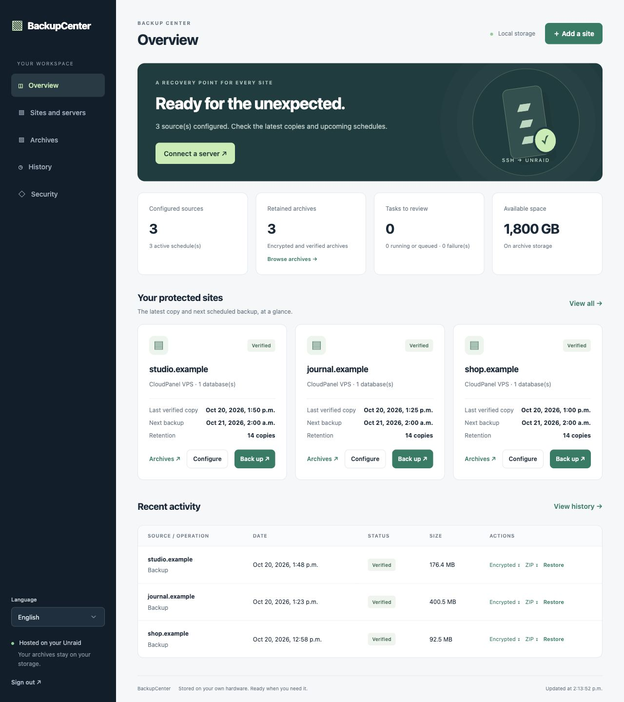
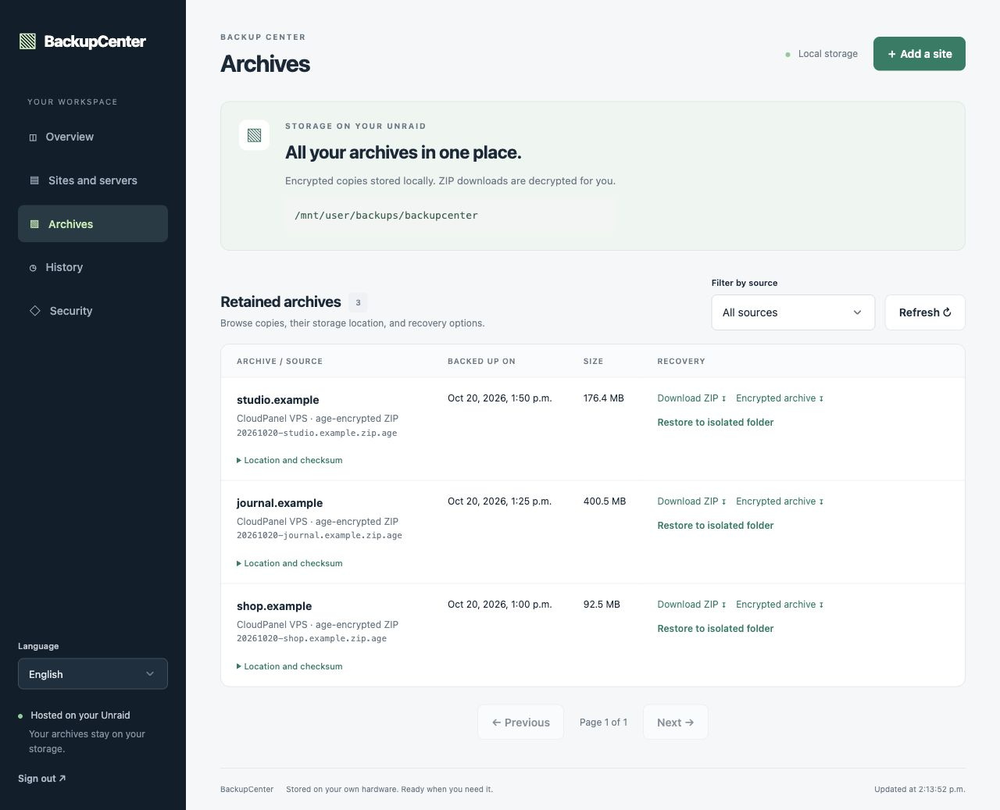

# BackupCenter

[Français](README.fr.md) · English

A self-hosted backup dashboard for CloudPanel websites and Linux VPS servers. Back up over SSH to your own storage, manage schedules and retention, download encrypted archives, and test recovery in isolated folders.


Browser sessions last 30 days and renew with activity. Signing out clears the browser session; password or TOTP changes invalidate other sessions.

## Screenshots

English interface shown with fictional demonstration data; no real servers, credentials or backups are displayed.

**Dashboard: sources, schedules and backup status**



**Archive browser: storage, downloads and isolated recovery**



## Features

- English and French interface, remembered per browser; localized dates and API messages.
- Dedicated Ed25519 key generation when adding a server. The private key is prefilled; a public-key installation command is ready to copy into a trusted provider console.
- SSH host fingerprint verification; existing connections never rotate keys automatically.
- One connection per VPS, CloudPanel folder/NGINX site discovery, alias grouping, and explicit selection of sites and databases.
- MySQL credentials configured once per server, with optional per-site overrides.
- Manual and scheduled backups; encrypted `.zip.age` archives containing files, SQL dumps, and a checksum manifest.
- Archive browser with source filters, pagination, storage paths, and ZIP/encrypted downloads.
- Password authentication, optional TOTP, CSRF protection, encrypted stored credentials, audit events, and configuration version checks.

## Run with Docker Compose

Requires Docker Compose and an HTTPS reverse proxy or tunnel. The bundled proxy binds to `127.0.0.1:8080` by default.

```sh
cp .env.example .env
# Edit .env: domain, local storage paths, bind address, timezone.
docker compose up -d --build
```

Point your existing HTTPS proxy at the configured listener. Keep `BACKUPCENTER_SECURE_COOKIE=1` for HTTPS. A containerized tunnel may require a suitable network route or a different bind address; expose only the intended listener. Use absolute storage paths for production, for example `/mnt/user/appdata/backupcenter/data` and `/mnt/user/backups/backupcenter` on Unraid.

Retrieve the first-run setup code from your own terminal, then enter it in the web interface:

```sh
docker compose exec backupcenter cat /data/setup-code.txt
```

Create an administrator password (at least 14 characters), enable TOTP, and download the archive recovery key. Keep that key and a protected copy of the application configuration outside this machine.

## Connect a VPS

1. Add the hostname/IP, SSH port, and user. Root is required for all-site/system access in this version; a restricted user can only back up accessible resources.
2. A dedicated private key is generated and prefilled. Copy only the displayed **public-key installation command** into a trusted provider console. It preserves existing authorized keys.
3. Save the server. Compare its SSH fingerprints against the provider console before trusting them.
4. Test SSH, discover sites, and explicitly confirm the databases for each site. Run a manual backup before enabling schedules.

The installation command grants the selected account’s privileges. For root this is administrator access. The `restrict` SSH option disables forwarding and interactive terminals; it does not make root commands read-only. Existing keys are kept unless you explicitly generate and save a replacement. Generating a new pair does not revoke old public keys on the VPS.

Never paste a private key into the VPS console, a chat, an issue, or a repository. Generated private keys are returned only to the authenticated form over your HTTPS connection, not stored in cookies, and encrypted when the server connection is saved.

See [SSH setup](docs/vps-access.md).

## Database discovery and consistency

The remote server needs Python 3, GNU tar, and MySQL/MariaDB client tools. Automatic MySQL mode tries a protected `/root/.my.cnf` or root’s default local database connection. Linux root access does not guarantee MySQL access; configure a protected remote client file or MySQL credentials if necessary. MySQL need not be exposed to the Internet.

Discovery reads common `.env`, WordPress, and PHP configurations without executing application code. Accessible databases are not proof of site ownership: review each selection. Custom layouts and dynamic configuration require manual selection.

Files are copied while the site is running; MySQL uses transactional dumps. This alone does not ensure consistency between files and SQL or for non-transactional tables. Quiesce writes when application consistency requires it.

## Archives and recovery

A backup contains `files.tar.gz`, SQL dumps, and `manifest.json`. The ZIP is verified, encrypted with age, decrypted for verification, then published atomically. Retention removes old copies only after a new successful backup.

The archive browser displays the configured host storage path. ZIP downloads are decrypted; encrypted downloads require the recovery key:

```sh
age -d -i BackupCenter-recovery.key -o backup.zip archive.zip.age
```

Restoration currently transfers and extracts into a **new isolated folder on the source server**, requiring Python 3.12+. It does not replace live files or import production databases. Full CloudPanel reconstruction, production SQL imports, and bare-metal recovery require a separately tested procedure.

A full VPS backup covers accessible files on the root filesystem and all logical databases. It excludes virtual filesystems, `/mnt`, `/media`, raw MySQL files, Docker data, and swap. Separate mounted volumes need additional sources. It is **not a bootable disk image** or an OVHcloud snapshot.

Copies are full archives, not incremental. Provision sufficient temporary space for the compressed files, ZIP, and decrypted verification copy. External notifications and provider snapshot automation are not implemented.

## Development and repository hygiene

See [testing](docs-validation.md). Runtime data, keys, `.env`, personal deployment notes, and screenshots belong in ignored local/private directories. Do not add them with `git add -f`. `.env.example` contains only generic values. No GitHub repository is created or published by this project setup.

This application can hold administrator SSH and database credentials. Review the code and deployment permissions before using it for critical systems. A verified archive is not a substitute for a restoration drill.

## Backup schedule

Backup time defaults to **02:00** in the configured `TZ` time zone and can be changed for each source or during site discovery. Daily, weekly and 30-day schedules preserve local time across daylight saving changes. A nonexistent spring time shifts forward by the clock gap; a repeated fall time runs once. Existing sources migrate to 02:00. Subdaily schedules repeat from the selected time.

## Support the project

If BackupCenter helps you, you can support its development via PayPal.

[☕ Buy me a coffee](https://www.paypal.com/cgi-bin/webscr?cmd=_donations&business=vcadieux%40vincentcadieux.com&item_name=BackupCenter&currency_code=CAD)

## Server updates

On a server card, choose **Updates**. Checks use the authenticated session without asking for credentials again. Installation requires a fresh password and TOTP (if enabled). Checks run `apt-get update` and simulate `apt-get upgrade`; review the package plan, then type **Yes** (or **Oui**) to install within 15 minutes. Requires a pinned root SSH connection, Debian/Ubuntu and systemd. Services may restart and sites may be interrupted. Local configuration files are kept; no automatic reboot, package removal, autoremove or distribution upgrade is performed. Held-back packages remain pending. BackupCenter serializes maintenance with its backups across all servers. External APT jobs and backups are outside this coordination. Jobs survive SSH disconnects via transient systemd services; an unknown outcome pauses backups until status is recovered. Sanitized package names and phases are shown; raw command logs and an interactive terminal are not exposed. Keep a recent backup. Remote operation metadata remains under `/var/lib/backupcenter-maintenance` for diagnosis. This manages OS packages, not CloudPanel version upgrades.

## Interactive SSH terminal

Open **SSH terminal** on a server card, then enter the VPS username at `login:` and its password at the SSH prompt. The existing BackupCenter browser session is required. The terminal uses password authentication only; backup keys remain unchanged and are not offered for terminal login. The VPS must already allow SSH password authentication for that account and PTY allocation. Root password login must already be allowed if you choose root. BackupCenter does not change sshd policy, install keys or enable root passwords. Host fingerprints must be confirmed beforehand.

Only one terminal can be open across this instance. BackupCenter pauses its backups and package maintenance until it closes. Server edits are blocked during the session. Automatic closure occurs after 5 minutes without input or 30 minutes total; polling does not extend these limits. Closing, logging out or revoking the browser authentication closes the SSH process. Detached remote tasks may continue, while foreground commands may be interrupted. Existing external jobs are not coordinated.

Terminal input, passwords and transcripts are not written to the BackupCenter database or audit log. Output is buffered in memory with a 1 MiB limit and cleared shortly after closure; remote shell history and server-side SSH logs are controlled by the VPS. The browser has bounded scrollback and clears it on close. Clipboard escape sequences, clickable terminal links and SSH forwarding are disabled. HTTPS polling uses the existing proxy; no extra port or WebSocket configuration is required. Vendored xterm.js 6.0.0 and fit addon 0.11.0 retain their MIT licenses under `public/vendor/xterm`. A small local xterm patch attaches the per-response CSP nonce to generated style elements; preserve this patch when updating xterm. The terminal dialog adapts to the viewport and keeps its disconnect controls visible.
